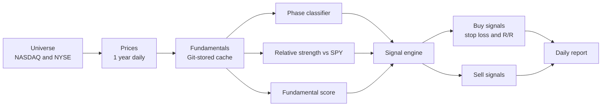

# Stock Screener

A daily US stock screener that finds Phase 2 uptrends using Minervini's Trend Template, relative strength against SPY, and a fundamentals screen, then proposes a stop loss and risk/reward for each buy signal.

[](https://github.com/RyanJHamby/stock-screener/actions/workflows/tests.yml)
[](https://github.com/RyanJHamby/stock-screener/actions/workflows/daily_screening_git_storage.yml)
[](https://www.python.org/)
[](LICENSE)


Not financial advice. See the [disclaimer](#disclaimer).

## Try it

```bash
pip install -r requirements.txt
just scan-test      # small scan; needs network access
```

## What it does

- Fetches the NASDAQ/NYSE universe and one year of daily prices (yfinance).
- Classifies each stock into one of four trend phases and scores relative strength against SPY.
- Scores fundamentals (revenue, EPS, inventory) for Phase 1 and 2 stocks.
- Emits ranked buy and sell signals, with a stop loss and risk/reward for each buy.
- Only emits buy signals when the market itself is healthy (SPY phase and breadth).
- Runs on GitHub Actions each weekday and commits the report to `data/daily_scans/`.
- Optionally reads Robinhood positions (read-only) and recommends trailing stops.

## Quick start

Requires Python 3.12+.

```bash
git clone https://github.com/RyanJHamby/stock-screener.git
cd stock-screener
python -m venv venv && source venv/bin/activate
pip install -r requirements.txt
cp .env.example .env          # optional; every setting in it is off by default
just setup-check              # shows what is configured
just scan-test                # small test-mode scan
just scan                     # full market scan, conservative rate limits
just dashboard                # local dashboard on port 5050
```

Without `just`, the recipes are in the [justfile](justfile). Reports are written to
`data/daily_scans/`; the newest is `latest_optimized_scan.txt`.

Run the tests with `pytest tests/ --ignore=tests/test_email_full.py`.

`run_test.sh` and `run_screen.sh` run the older 30-ticker engine from `config.yaml`
(`tests/test_quant_engine.py`, `scripts/run_quant_engine.py`). Known issue: that engine
currently crashes at `src/screening/quant_engine.py:289`. Use the `just` recipes instead.

## How it works



A buy signal requires a Phase 2 stock that passes 7 of Minervini's 8 Trend Template criteria:

1. Price above the 150 and 200 SMA
2. 150 SMA above the 200 SMA
3. 200 SMA rising for at least a month
4. 50 SMA above 150 SMA above 200 SMA
5. Price above the 50 SMA
6. Price at least 30% above the 52-week low
7. Price within 25% of the 52-week high
8. Relative strength slope of +0.15 or more

Details: [methodology](docs/METHODOLOGY.md), [scoring and stop loss](docs/TECHNICAL_DETAILS.md), [position management](docs/POSITION_MANAGEMENT.md), [roadmap ideas](docs/ROADMAP.md).

## Results

Taken from the 49 scan reports in `data/daily_scans/` (2026-09-01 to 2026-11-06), which ran on GitHub Actions:

| Measure | Range across reports |
|---|---|
| Universe size | 3,753 to 3,773 stocks |
| Stocks analyzed per run | 1,624 to 1,846 |
| Processing time | 62.6 to 62.9 minutes |
| Error rate | 3.4% to 8.8% |

Only about half the universe is analyzed on a given run. These figures are read from the saved reports, not from a benchmark run on named hardware. There is no backtest, so nothing here says whether the signals make money.

## Configuration

All optional, set in `.env` (see [.env.example](.env.example)):

| Setting | Purpose |
|---|---|
| `DATABASE_URL` | Database for stored results |
| `EMAIL_FROM`, `EMAIL_PASSWORD`, `EMAIL_TO`, `EMAIL_SMTP_*` | Email notifications |
| `SLACK_WEBHOOK_URL` or `SLACK_BOT_TOKEN` | Slack notifications |
| `FMP_API_KEY` | Financial Modeling Prep fundamentals ([setup](docs/SETUP_FMP.md)) |
| `ROBINHOOD_USERNAME` | Read-only position tracking; the password is prompted, never stored |

## How this was built

I wrote this project with AI coding assistants. Claude Code agents opened some pull requests on `agent/*` branches, which I reviewed and merged. The signal logic follows Minervini's published method; the tests and the daily scan reports are the evidence of what it does.

## Disclaimer

For educational and informational purposes only. Not financial advice. Past performance does not guarantee future results, and trading involves risk of loss. The author is not responsible for losses from using this software.

## License

MIT. See [LICENSE](LICENSE). Contributions: see [CONTRIBUTING.md](CONTRIBUTING.md).
